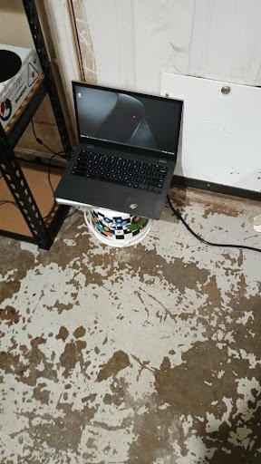

# chromebook-server

Turning an old Chromebook into a working server environment to learn Linux hosting and remote monitoring.

This is the actual machine that runs my site, [natestechstuff.com](https://natestechstuff.com).

Yeah it's sitting on a bucket in the garage. It works.

## The setup

- **The hardware:** an old Acer Chromebook running Linux (Ubuntu-based) instead of ChromeOS.
- **Web server:** nginx serves the site straight off the Chromebook.
- **Getting it online:** a Cloudflare Tunnel (`cloudflared`). The Chromebook connects out to Cloudflare, so there's no port forwarding and my home IP never gets exposed.
- **Remote access:** Tailscale + SSH, so I can get into it from anywhere without opening anything on the router.
- **Backup:** a 2010 MacBook Pro runs the same site as a failover. If the Chromebook goes down, the MacBook keeps it up.

Basically two old laptops nobody wanted are now running a real website.

## What I learned

- How to install and set up Linux on hardware that wasn't really made for it
- How nginx works: server blocks, where the files go, reloading without breaking stuff
- You don't need port forwarding to host something. Tunnels are way easier and safer
- Setting up SSH and Tailscale so I can fix things when I'm not home
- Why a failover is worth it, because stuff will go down at the worst time
- Checking temps, logs and services so I know when something's wrong before it breaks

## Why

I wanted to learn how hosting actually works instead of just paying someone to do it. Old hardware is free and if I break it, whatever, I fix it.

---

Check out the site: **[natestechstuff.com](https://natestechstuff.com)**
